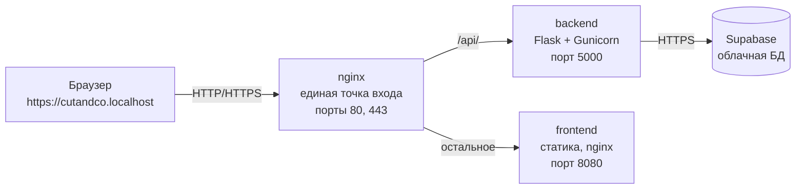

# Практическое занятие №18 — Деплой приложения (репетиция)

**Проект:** cutandco (барбершоп) — фронтенд React + Vite, бэкенд Flask, база данных Supabase (облачная).
Фронтенд и бэкенд хранятся в одном репозитории, поэтому папка `deploy/` создана внутри него.

## 1. Схема архитектуры

Снаружи доступен только nginx (порты 80/443, привязаны к 127.0.0.1). Запросы `/api/` он передаёт бэкенду, всё остальное — фронтенду. Бэкенд подключается к облачной базе Supabase по сети.



## 2. Таблица сервисов

| Сервис | Технология | Внутренний порт | Продакшен-сервер |
|---|---|---|---|
| frontend | React + Vite (SPA, статика) | 8080 | nginx (nginxinc/nginx-unprivileged) |
| backend | Flask (Python 3.12) | 5000 | Gunicorn (2 воркера) |
| nginx | nginx 1.27 (alpine) | 80, 443 | — (обратный прокси) |
| База данных | Supabase (облачная) | — | — |

Фронтенд собирается многоэтапной сборкой: этап `node:22-alpine` (npm ci + npm run build), итоговый образ — чистый nginx, куда копируется только папка `dist`.

## 3. Переменные окружения и секреты (только имена, без значений)

| Имя | Где задаётся | Назначение |
|---|---|---|
| `SUPABASE_URL` | `backend/.env` (не в репозитории) | адрес проекта Supabase |
| `SUPABASE_KEY` | `backend/.env` (не в репозитории) | ключ доступа к Supabase |

- `backend/.env.example` — шаблон со списком переменных (в репозитории, значений нет).
- Если переменные не заданы, бэкенд работает на данных в памяти (fallback для локальной проверки и CI).
- Папка `deploy/certs/` с сертификатом и закрытым ключом исключена из репозитория (`.gitignore`).
- Секреты не попадают в Docker-образы: `backend/.env` исключён в `backend/.dockerignore`, переменные передаются контейнеру при запуске через `env_file` в `docker-compose.yml`.
- Фронтенд не использует переменные сборки: адрес API относительный (`/api/...`), поэтому запросы идут на тот же адрес, что и сайт, — через nginx. Секретов в браузерном коде нет.

## 4. Команды запуска и остановки

Выполняются из папки `deploy/` при запущенном Docker Desktop:

```bash
# один раз: установка локального центра сертификации (от имени администратора)
winget install -e --id FiloSottile.mkcert
mkcert -install

# один раз: выпуск сертификата для домена проекта
cd deploy/certs
mkcert -cert-file cutandco.localhost.pem -key-file cutandco.localhost-key.pem cutandco.localhost

# сборка и запуск всех сервисов
docker compose up --build -d

# проверка состояния / журналов
docker compose ps
docker compose logs backend

# остановка
docker compose down
```

После запуска проект открывается по адресу **https://cutandco.localhost** (Chrome или Edge; http-версия сама перенаправляется на https).

## 5. Скриншоты

Сохранены в папке [`screenshots/`](./screenshots/):

| Файл | Что должно быть видно |
|---|---|
| `01-compose-ps.png` | вывод `docker compose ps` — все сервисы `Up (running)` |
| `02-site-https.png` | сайт по https://cutandco.localhost, замок в адресной строке, без предупреждений |
| `03-network-api.png` | вкладка Network: успешный запрос к `/api/services` и заголовок `X-Robots-Tag` в ответе |
| `04-docker-desktop.png` | Docker Desktop: порты открыты только у контейнера nginx |
| `05-actions.png` | успешное выполнение workflow GitHub Actions (доп. задание) |

## 6. Ошибки, возникшие при выполнении работы, и способы их устранения

| Ошибка | Причина | Решение |
|---|---|---|
| Предупреждение о недоверенном сертификате в браузере | Не выполнен `mkcert -install` или сертификат выпущен до установки локального ЦС | Выполнить `mkcert -install` (администратор), затем перевыпустить сертификат |
| `nginx` не стартует: `cannot load certificate` | Нет файлов в `deploy/certs/` или имена не совпадают с путями в `nginx.conf` | Выпустить сертификат именно с именами `cutandco.localhost.pem` и `cutandco.localhost-key.pem` |
| `docker compose` ругается на отсутствие `.env` | Файл `backend/.env` отсутствует | Создать его по шаблону `backend/.env.example` (значения можно оставить пустыми — бэкенд перейдёт на данные в памяти) |
| После изменения кода изменений на сайте нет | Образы не пересобраны | `docker compose up --build -d` |

<!-- TODO(студент): допишите сюда ошибки, которые встретились лично у вас -->

## 7. Что нужно изменить для публикации на реальном сервере

1. Арендовать сервер/VPS (для данных пользователей — у российского провайдера, чтобы соблюдать 152-ФЗ, либо перенести данные в российское облако).
2. Зарегистрировать настоящий домен и создать A-запись на IP сервера вместо `*.localhost`.
3. Получить сертификат у публичного центра сертификации (Let's Encrypt через Certbot) вместо mkcert; продление — автоматическое.
4. Опубликовать образы в реестре (GHCR — workflow уже публикует их на main) и на сервере запускать `docker compose` с образами из реестра, а не локальной сборкой (CD).
5. Открыть порты 80/443 на публичные адреса (убрать привязку `127.0.0.1`), настроить firewall.
6. Подключить реальные секреты (Supabase) на сервере через `.env` вне репозитория.
7. Настроить мониторинг и резервное копирование.

Порядок развёртывания при этом остаётся тем же, что и в этой репетиции.

## 8. CI/CD

Workflow [`.github/workflows/build.yml`](../.github/workflows/build.yml) запускается при каждом `push` (в любую ветку), `pull_request` и вручную (`workflow_dispatch`):

1. `test` — тесты бэкенда (pytest);
2. `build-backend` — сборка Docker-образа бэкенда;
3. `build-frontend` — сборка Docker-образа фронтенда;
4. `publish` (доп. задание, только ветка `main`) — публикация образов в GitHub Container Registry с тегами `latest` и хэшем коммита.

Сборке образов секреты не нужны: ключ Supabase подключается только при запуске контейнера, а фронтенд собирается без переменных окружения.
